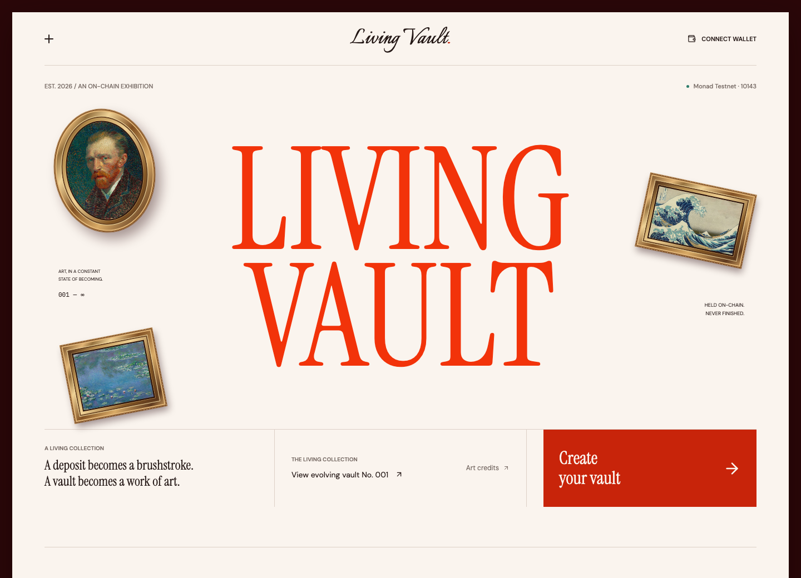
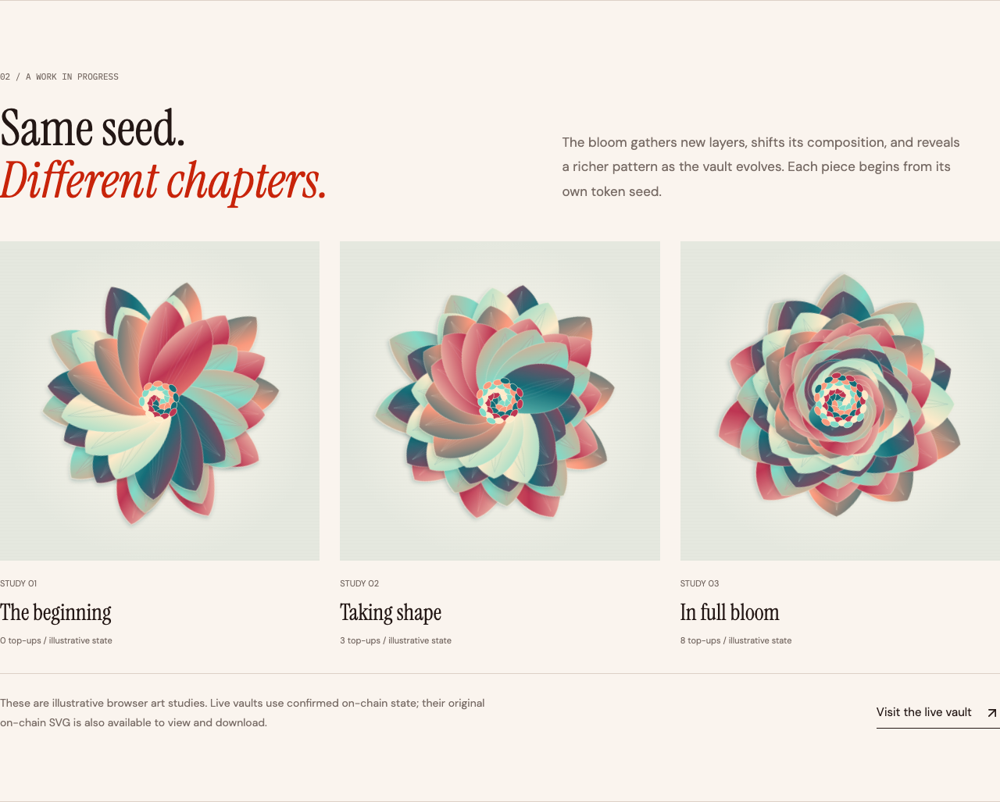
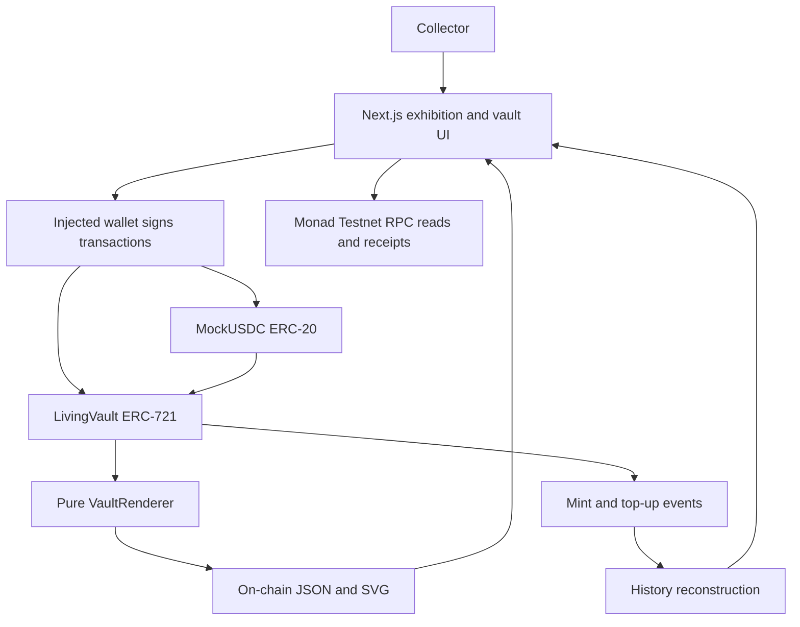

# Living Vault

### Art that remembers what you do.

A generative NFT with a deposit vault inside it. Add test tokens, watch the artwork evolve, and carry the balance and its history with the NFT when ownership changes.

**[Open the live app](https://living-vault-three.vercel.app) · [Create your own piece](https://living-vault-three.vercel.app/create) · [Read the platform guide](https://living-vault-three.vercel.app/docs)**

Built and deployed on **Monad Testnet, chain 10143**. This edition uses **mUSDC, a free test token with no monetary value or yield**. No mainnet deployment is included.



## For Judges: Start Here

Living Vault turns an evolving collectible into a working ownership loop: **deposit → mint → evolve → transfer → redeem**. The visual change follows a confirmed contract transaction, so the demo shows both an artistic result and an independently verifiable state change.

| Explore | Link | What to look for |
| --- | --- | --- |
| The exhibition | [Live homepage](https://living-vault-three.vercel.app) | Museum-inspired typography, paintings, evolution studies and the product story |
| On-chain evolution proof | [Recorded vault No. 1 evidence](docs/testnet-evidence.json) | Confirmed mint and deposits, principal, image digests and renderer equality |
| Interactive demo | [Create a vault](https://living-vault-three.vercel.app/create) | Claim test tokens, mint, then deposit again to evolve your own piece |
| Platform guide | [Documentation](https://living-vault-three.vercel.app/docs) | Lifecycle, contracts, economics, provenance, troubleshooting and FAQ |
| Evidence | [Verification record](docs/VERIFICATION.md) | Public transaction hashes, source verification and exact testing limits |

The exhibition, docs and public vault pages work without a wallet. Creating or changing a vault requires a wallet signature.

## The Idea

Most collectibles preserve a single moment. Living Vault preserves a sequence of actions. Every NFT has its own identity and token balance; every confirmed top-up changes the state used to generate its artwork. Its visual history becomes a record of participation.

The original artwork is deterministic: the same token ID, principal and top-up count produce the same SVG. A transfer keeps that state intact. Redemption ends the edition by returning the entire principal to the current owner and burning the NFT.

The result is a living object that can be owned, developed, passed on and closed, with the financial and visual rules visible in the contract.

## Demo Walkthrough

Use a desktop browser with MetaMask or another compatible injected wallet, funded with **test MON** for network fees. The app can request Monad Testnet when you connect.

1. Open [Create a vault](https://living-vault-three.vercel.app/create) and connect on chain **10143**.
2. Claim **1,000 test mUSDC** from the built-in faucet and wait for confirmation.
3. Enter an initial deposit of at least **1 mUSDC**, approve the requested token amount if needed, then confirm minting.
4. Open the new piece and choose **Add to vault**. Enter a positive amount, select **Deposit & evolve**, and confirm approval and deposit if requested.
5. After the receipt confirms and state refreshes, the artwork changes, the balance increases, and a history entry appears. Open the transaction link to verify it.
6. Use the eye control to view the original on-chain artwork, or download its exact SVG.

For a presentation, have test MON ready beforehand. Approval alone does not evolve the artwork; the subsequent deposit transaction does. A rejected signature makes no state change.

**Optional ownership demo:** transfer your own NFT to a second wallet and inspect it there. Redeeming pays the full principal to the current owner and permanently burns that NFT, so use a disposable demo piece for this step.



## What Works

| Feature | Implemented behavior |
| --- | --- |
| Wallet connection | Injected wallet selection, account connection and Monad Testnet switching |
| Test-token faucet | 1,000 mUSDC per claim, six decimals, 60-second cooldown per address |
| Mint | Deposit at least 1 mUSDC; receive an ERC-721 with principal and mint timestamp |
| Deposit and evolution | Authorized positive top-ups increase principal and count, update artwork and emit metadata events |
| Collection | Connected-wallet NFT gallery and public read-only detail pages |
| History | Reconstruct prior artwork states from mint/top-up event arguments |
| Transfer | ERC-721 transfer carries the vault balance and redemption rights |
| Redemption | Atomic full payout to the current owner and irreversible NFT burn |
| Artwork tools | Browser/original view toggle, exact on-chain SVG export and sharing |
| Transaction feedback | Signature, pending receipt, confirmation, explorer links and refresh recovery |
| Deployment | Wallet-signed two-contract testnet deployment; optional server-side CLI |
| Documentation | Responsive guide, FAQ, contract links, token model and artwork credits |

## How the Artwork Evolves

There are two intentionally distinct visual layers:

**Original NFT artwork:** `VaultRenderer.sol` generates SVG from token ID, principal balance tier and top-up count. SVG and JSON metadata are encoded in the contract's `tokenURI`. The original NFT image needs no IPFS gateway, database or external image server. Top-ups emit ERC-4906 `MetadataUpdate` events.

**Browser art presentation:** the website defaults to a richer sculptural bloom derived from the original SVG's state descriptors. It follows confirmed chain state but does not replace immutable metadata. The eye control exposes the original, and SVG download always exports the original. Homepage evolution studies are illustrative examples, not transactions or owned NFTs.

The original renderer caps its structural level at **8** and balance tier at **7**. Rotation and the top-up tally continue changing beyond level eight. The bloom also responds to count and balance tier. Token ID seeds each piece's identity.

The Van Gogh, Monet and Hokusai paintings on the landing page are editorial public-domain artwork, not NFT outputs. See [Artwork Credits](docs/ARTWORK_CREDITS.md).

## Actual Monad Testnet Evidence

Both contracts were deployed through the user's wallet on **October 10, 2026**. Verification responses report **MonadVision perfect match** and **Monadscan Pass - Verified** for both. Responses are preserved in [deployment configuration](config/deployment.json).

| Contract | Testnet address |
| --- | --- |
| MockUSDC | [`0x2937e4a29f6a60ee56375f7b3fd9b71542ec6afb`](https://testnet.monadvision.com/address/0x2937e4a29f6a60ee56375f7b3fd9b71542ec6afb) |
| LivingVault | [`0x760600d4fdd56b49941fa91b096666d56c08ec5f`](https://testnet.monadvision.com/address/0x760600d4fdd56b49941fa91b096666d56c08ec5f) |

At the recorded RPC checkpoint, **2026-10-10 07:35:13 UTC**, vault No. 1 held **21 mUSDC**, had **two confirmed top-ups**, and was at **level 2**. Its decoded SVG exactly matched the deployed renderer and differed from the mint image. These are historical evidence values; the live page reads current state.

| Action | Amount | Confirmed transaction |
| --- | --- | --- |
| Mint vault No. 1 | 1 mUSDC | [Mint receipt](https://testnet.monadvision.com/tx/0x743c3291242b2fa31c18037b770268bab8e02eedf222e0a440b2af9f692b26a2) |
| First evolution | 10 mUSDC | [First top-up receipt](https://testnet.monadvision.com/tx/0x847433ee321458f270d8c90988ca2598681220adb20649d137b93120b0e0f161) |
| Second evolution | 10 mUSDC | [Second top-up receipt](https://testnet.monadvision.com/tx/0x4b0aa0f91fe89e8bad4f9e00300c15f332013ded42e455f7910df96ded5399af) |

[Machine-readable evidence](docs/testnet-evidence.json) records receipt blocks, amounts, owner, custody balance, SVG digests and renderer equality. [Verification details](docs/VERIFICATION.md) distinguish public observations from local tests. Source verification is not a security audit.

**Current demo state:** a fresh RPC check on October 10 found total supply **0**, next token ID **2**, and a reverted ownership lookup for previously minted vault No. 1. The hosted page also reports it as redeemed. Its mint/evolution evidence remains valid as a historical checkpoint, but it is no longer an active demo NFT. Create a fresh vault to demonstrate evolution. The old-vault evidence command will fail for burned No. 1; for a new evolved token, run `npm run test:testnet -- <token-id>`.

## Why Monad

Living Vault makes a wallet action visible as artwork, so confirmation and refreshed reads sit directly in the experience. This edition implements that interaction on Monad Testnet using direct contract reads and wallet-signed writes.

The transaction path estimates gas against the active RPC, adds a **5% limit buffer**, and supplies explicit gas and fee caps. History uses bounded queries compatible with the observed RPC's 100-block log range limit. These are implementation choices; the project does not claim a measured latency or throughput benchmark.

## Architecture



The main application has no backend database or indexer. Public RPC supplies ownership, balances, metadata and logs. React Query manages cached reads, Wagmi handles wallets, and Viem handles contract calls and receipts.

| Layer | Stack |
| --- | --- |
| Application | Next.js 16.4.0 App Router, React 19.2.4, TypeScript |
| Wallet and data | Wagmi 3.7.7, Viem, TanStack React Query |
| Contracts | Solidity 0.8.31, OpenZeppelin 5.6.1, Osaka, optimizer 200 runs, viaIR |
| Local EVM | Hardhat 3.19.0, chain 31337 |
| Browser checks | Playwright with an isolated app and local test wallet |
| Hosting | Vercel, public deployment configuration, no server signing key required |
| Design | Custom CSS, Instrument Serif / DM Sans / Italianno / IBM Plex Mono, Lucide |

## Contract Rules and Ownership

- `mint(amount, recipient)` collects tokens from the caller and safely mints to the recipient. Minimum initial deposit: 1 mUSDC.
- `topUp(tokenId, amount)` accepts any positive six-decimal amount from the owner or an approved ERC-721 operator. It updates principal, count and metadata.
- Standard ERC-721 transfers preserve principal and art state. The recipient gains redemption rights.
- `redeem(tokenId)` is available to the owner or an approved operator. Payout always goes to the **current owner**, including when an operator initiates it. Full principal is returned and the NFT burns atomically.
- There are no partial withdrawals, vault administrators, upgrade proxies or yield strategies.
- SafeERC20 and reentrancy protection cover token movement. Deposits that do not deliver the exact amount are rejected. A failed payout reverts the burn and accounting.
- Principal is bounded to `uint128`; casts reject overflow. IDs remain monotonic after burns.
- The mock token deployer can seed test balances. The faucet token is intentionally not scarce.

The interface uses exact-amount ERC-20 approvals and skips approval when allowance covers the deposit. It validates six-decimal amounts and checks networks before writes. A failed read after confirmation offers refresh recovery instead of reporting a successful transaction as failed.

## Run Locally

Use **Node.js 22.10 or newer** and npm. The committed configuration points to the testnet deployment. No private key or environment file is needed to browse or use your browser wallet.

```sh
git clone https://github.com/neelpote/living-vault.git
cd living-vault
npm ci
npm run dev
```

Open [http://localhost:3000](http://localhost:3000). Regenerate contract ABIs, public bytecode and verification input with:

```sh
npm run contracts:compile
```

## Verification and Tests

```sh
# Generate the artifacts used by contract and browser tests.
npm run contracts:compile
npm run contracts:test
node scripts/test-demo-art.mjs

# Run sequentially: Next generates route types during the build.
npm run build
npm run typecheck

# Starts and stops its own isolated application and local chain.
npx playwright install chromium
npm run test:e2e

# Read-only public-chain check; refreshes the evidence file.
npm run test:testnet
```

| Check | Recorded result |
| --- | --- |
| Contract suite | 19 groups passed: mint, faucet, authorization, evolution, transfer, burn, overflow and failure rollback |
| Wallet browser suite | 22 checks passed: deployment, approvals, rejection, pending/refresh, mint, top-up, transfer, export and redemption |
| Demo renderer | Deterministic seed/tier behavior, distinct counts 0-12, bounded SVG size |
| Latest frontend | Production build and typecheck passed |
| Latest landing layout | 1440, 1024, 768, 390 and 320px: images loaded, FAQ works, no overflow or page errors |
| Public testnet | Actual user-wallet mint and two top-ups; receipts, accounting, mutation and renderer equality verified |

The browser suite uses local EVM port **18546** and a temporary app on **3001**. Contract tests use **18545**. Tests preserve shared testnet configuration and never sign public-chain transactions. Reports/screenshots go into ignored `test-results/`.

**Validation limits:** public-chain transfer and redemption have not been exercised through the user's wallet; they are tested locally. A hosted wallet-signing walkthrough, timed judge demo and independent audit are not claimed. Testnet resets and RPC outages can affect availability. The public evidence script scans history in small ranges and may take longer as the chain advances.

## Deploy Your Own Testnet Edition

1. Run locally and open `/deploy` with a funded testnet wallet.
2. Deploy MockUSDC, then LivingVault, confirming both transactions in your wallet.
3. On localhost, checked addresses can be saved to `config/deployment.json`. On hosted sites, download the configuration and replace the shared file before rebuilding.
4. Run `npm run contracts:compile` and `npm run contracts:verify`, or use local source verification. Inspect results and explorer source tabs; submission alone is not verification.
5. Rebuild and host with your new public configuration.

Optional `npm run contracts:deploy` reads `DEPLOYER_PRIVATE_KEY` from ignored `.env.local` and rejects RPCs outside chain 10143. [`.env.example`](.env.example) documents server-only variables. Never put keys in `NEXT_PUBLIC_*` variables or commit an environment file.

For production hosting:

```sh
npm run build
npm start
```

Vercel explicitly uses Next.js through `vercel.json`. Local persistence/verification API helpers reject production use. Normal interactions go directly through RPC and the wallet. Use a wallet-enabled browser when an embedded browser lacks wallet extensions.

## Repository Map

| Path | Purpose |
| --- | --- |
| `contracts/LivingVault.sol` | NFT, accounting, authorization, mint/top-up/redemption and metadata |
| `contracts/VaultRenderer.sol` | Deterministic original on-chain SVG |
| `contracts/MockUSDC.sol` | Six-decimal test token and faucet |
| `contracts/test/HostileToken.sol` | Adversarial token test fixture |
| `app/` | Homepage, create, vault, deploy, documentation and local-only helper routes |
| `components/` | Exhibition, wallet, collection, vault actions and transaction feedback |
| `lib/hooks.ts`, `lib/chain.ts` | Reads, history, RPC and amount/metadata helpers |
| `lib/demo-art.ts` | Browser-only sculptural bloom |
| `lib/generated/`, `public/deploy/` | Generated ABIs and public creation bytecode |
| `config/deployment.json` | Public addresses and verification responses |
| `scripts/` | Compile, deploy, verify and automated checks |
| `public/art/` | Renderer previews, manifest and museum images |
| `docs/` | PRD, acceptance, evidence, credits and README screenshots |
| `AGENT_HANDOFF.md` | Factual state and continuation notes |

## Scope, Credits and Further Reading

This release evolves through **deposits**. Community votes, oracle-fed data, AI image generation, real USDC, interest and mainnet deployment are outside this edition. The [draft PRD](docs/PRD.md) and [acceptance checklist](docs/ACCEPTANCE.md) explain the completed scope.

Original contract SVGs, bloom presentation and documentation landscape illustrations are generated by project code. Museum sources and artist credits are in [Artwork Credits](docs/ARTWORK_CREDITS.md). Fonts use Google Fonts; icons use Lucide. Third-party assets and libraries retain their respective licenses.

The interface includes keyboard focus, labelled icons, dialog focus management and reduced-motion handling. A small scroll-entry transition accompanies landing studies; confirmed deposits drive actual vault evolution.

For technical continuation, read [AGENT_HANDOFF.md](AGENT_HANDOFF.md). For product understanding, open the [full platform guide](https://living-vault-three.vercel.app/docs).
