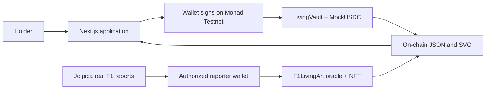

# Living Vault

**Art that remembers.** Generative NFTs that evolve through holder actions and real-world sports results, built on **Monad Testnet (10143)**.

**[Live App](https://living-vault-three.vercel.app) · [F1 Collection](https://living-vault-three.vercel.app/f1) · [Documentation](https://living-vault-three.vercel.app/docs) · [Demo Video](docs/videos/living-vault-product-demo.mp4)**

Public repository: [neelpote/living-vault](https://github.com/neelpote/living-vault). Publicly hosted on Vercel.


## The Idea

Most collectibles capture a single moment. Living Vault gives a piece a history: what its holder does, what it carries, and what happens in the world can change its visual identity.

The project demonstrates two distinct paths to that idea. **Deposit vaults** evolve through confirmed holder actions and carry a redeemable test-token balance. **F1 collectibles** evolve through published real sports results. Both generate original NFT artwork on-chain rather than relying on an external image being quietly replaced.

The demo is simple: send a deposit, wait for confirmation, and watch the piece change. The F1 collection extends the concept beyond wallet activity into an inspectable real-world data pipeline.

## What It Does

- **Holder-driven evolution:** deposit test mUSDC to mint a vault NFT, then top up to change its artwork. Transfer carries the balance; redeem returns it to the current owner and burns the NFT.
- **Real F1 data:** all 11 teams on the 2026 grid, with championship history and race results from Jolpica. Titles, points and wins shape original on-chain metallic artwork.
- **Verifiable outputs:** on-chain SVG/metadata, explorer receipts, downloadable source reports and source/published comparisons.

The F1 collection uses a **trusted single-reporter oracle**: the authorized wallet must publish genuinely changed results. It is not a decentralized feed or automatic updater. The report digest verifies the published report's bytes, not the truth of HTTP data. F1 NFTs have no deposit balance.

The deposit UI includes a richer browser presentation; the original-view toggle and SVG export expose the actual NFT artwork.

| Feature | What is implemented |
| --- | --- |
| Wallet connection | Injected wallets, account connection and Monad Testnet switching |
| Test-token faucet | 1,000 mUSDC per claim, six decimals, 60-second cooldown |
| Vault lifecycle | Mint, top up, transfer and full redemption with NFT burn |
| Collection and history | Wallet-owned gallery, public detail pages and event-derived evolution history |
| Artwork tools | Original SVG view/download and confirmed-state browser presentation |
| Sports collection | Team selection, real records, original on-chain art and free NFT mint |
| Provenance | Source/published comparisons, report digest, observation time and source links |
| Transaction feedback | Wallet signature, pending receipt, confirmation and explorer link |

## Real F1 Data, Living Artwork

The F1 collection covers **all 11 teams on the 2026 grid**, including Audi and Cadillac. Championship counts are derived from **68 completed seasons, 1958-2025**, using exact constructor identities. Predecessor championships are not silently inherited.

| Constructor | Titles through 2025 |
| --- | --- |
| Ferrari | 16 |
| McLaren | 10 |
| Williams | 9 |
| Mercedes | 8 |
| Red Bull | 6 |
| Alpine, Aston Martin, Audi, Cadillac, Haas, RB | 0 under these identities |

**Titles shape the turbine layers, race points rotate the composition, and wins influence blade orientation.** A new published report changes the original SVG of existing team-linked NFTs and emits ERC-4906 metadata-update notifications. A current-season championship is counted only once final scheduled results are available and the race date has passed.

Source: [Jolpica F1 API](https://github.com/jolpica/jolpica-f1/blob/main/docs/README.md). The page links championship years to their source responses and lets anyone download the canonical report. API results may be cached for five minutes; source and published values are shown separately. There is no synthetic result or forced evolution button.

## Verified Contracts

All three contracts are deployed on **Monad Testnet**, with source verified on MonadVision and Monadscan.

| Contract | Address / Explorer |
| --- | --- |
| LivingVault | [`0x760600d4fdd56b49941fa91b096666d56c08ec5f`](https://testnet.monadvision.com/address/0x760600d4fdd56b49941fa91b096666d56c08ec5f) |
| MockUSDC | [`0x2937e4a29f6a60ee56375f7b3fd9b71542ec6afb`](https://testnet.monadvision.com/address/0x2937e4a29f6a60ee56375f7b3fd9b71542ec6afb) |
| F1LivingArt | [`0x1ba990f986e74295b1a4f65c5d654ebaa6ee4451`](https://testnet.monadvision.com/address/0x1ba990f986e74295b1a4f65c5d654ebaa6ee4451) |

**Recorded public proof:** a deposit vault was minted and topped up twice, with accounting and SVG mutation checked against the deployed renderer. The separate F1 contract published the real round-16 report at deployment; all 11 team values were independently checked, and Ferrari NFT No. 1's image matched the original contract SVG.

[Vault receipts and evidence](docs/testnet-evidence.json) · [F1 evidence](docs/f1-testnet-evidence.json) · [Full verification record](docs/VERIFICATION.md)

These are recorded checkpoints, not promises about future live state. A post-deployment public F1 update has not yet been observed; real round-15 to round-16 evolution was tested locally without manufacturing a public update.

## Try It

Use a wallet-enabled browser with **test MON** for gas.

1. Open [Create](https://living-vault-three.vercel.app/create), connect on chain **10143**, and claim test mUSDC.
2. Deposit at least **1 mUSDC** to mint a vault, confirming approval and mint.
3. Open your vault, select **Add to vault → Deposit & evolve**, and confirm approval and deposit as required.
4. Watch the confirmed artwork change and open its explorer receipt. Approval alone does not evolve it.

On the [F1 page](https://living-vault-three.vercel.app/f1), choose a team, inspect its records and original SVG, then mint for test MON gas only. Old deposit vault No. 1 was redeemed; create a fresh vault for the live evolution demo.

**Ownership matters:** transferring a vault preserves its principal and artwork state. Redemption pays the full balance to the current owner and permanently burns that NFT. There are no partial withdrawals or yield strategies; use a disposable test vault for a redemption demo.

## How It Is Built



The application uses **Next.js, React and TypeScript**, with **Wagmi/Viem** for wallets and contract calls. Contracts use **Solidity 0.8.31 and OpenZeppelin**; Hardhat and Playwright cover contract and browser behavior. Hosting is on Vercel, with no application database or server signing key required.

The deposit contracts are immutable, with no upgrade proxy or vault administrator. F1 publishing is a separate contract with an immutable authorized reporter. The user's wallet retains its key and signs writes; the interface reads confirmed state from RPC. Exact-amount token approvals, network checks and reentrancy protection cover the deposit flow.

**Why Monad:** the product depends on a wallet action becoming visible as refreshed artwork. Monad Testnet is the deployed execution layer for that loop, with direct reads and wallet-signed writes. Gas is estimated against the active network with a 5% limit buffer; no unmeasured speed or throughput claim is made.

## Run Locally

Requires **Node.js 22.10+** and npm. No private key or environment file is needed; committed configuration points to the deployed testnet contracts.

```sh
git clone https://github.com/neelpote/living-vault.git
cd living-vault
npm ci
npm run dev
```

Open [localhost:3000](http://localhost:3000). Stack: Next.js, React, TypeScript, Wagmi/Viem, Solidity and OpenZeppelin.

## Check the Project

```sh
npm run contracts:compile
npm run contracts:test
npm run build
npm run typecheck
npm run f1:check
```

Fresh-clone setup, 19 contract checks, build and typecheck passed. Recorded browser checks cover the vault lifecycle; 14 F1 checks cover real-report evolution locally. Public evidence confirms vault deposits and the F1 deployment/mint. No public post-deployment F1 update or security audit is claimed.

For the wallet browser suite, run `npx playwright install chromium`, then `npm run test:e2e`. For the F1 suite, keep the development server running and run `npm run f1:test`. Both use isolated local chains, not public signing keys. GitHub Actions is configured for clean installation, contract tests, build and typecheck.

## Who It Is For

Artists and sports communities can use living collectibles to express ongoing participation rather than a static purchase. The proposed revenue model is **commissioned collections and optional hosted publishing services**, not returns on deposited funds.

Next validation steps are community interviews, artist-led pilots, and measuring independent mints and repeat visits after real results. Revenue and product-market fit are not yet established. Commercial sports branding and data rights require separate review; this prototype is not affiliated with Formula 1 or its teams.

## Scope and Further Reading

**Testnet only.** mUSDC has no monetary value or yield. No mainnet deployment or community voting. F1 updates require the reporter; API failures never substitute fabricated results.

[Platform Guide](https://living-vault-three.vercel.app/docs) · [Verification & Evidence](docs/VERIFICATION.md) · [Pitch & Submission Kit](docs/SUBMISSION.md) · [Artwork Credits](docs/ARTWORK_CREDITS.md) · [Agent Handoff](AGENT_HANDOFF.md)
